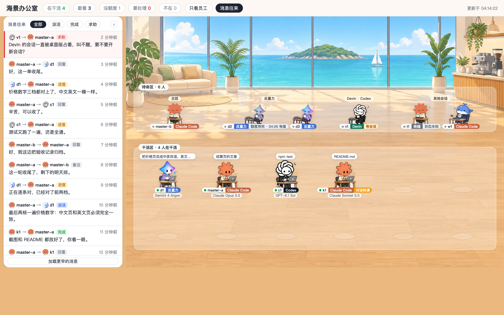
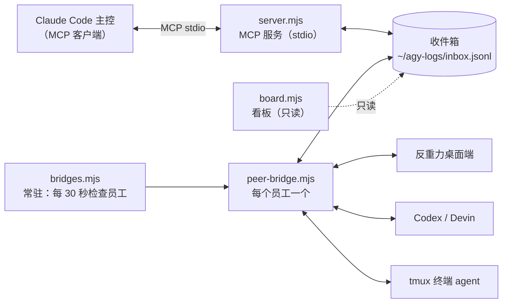
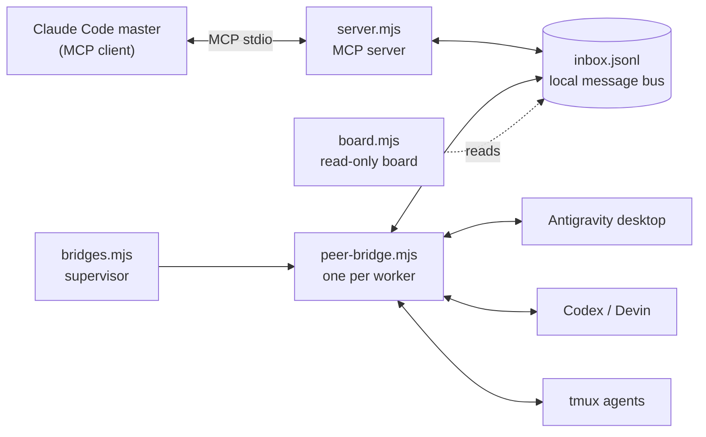

# agent-hub

**让 Claude Code（主控）和各类 agent 员工互相派活、发消息，并在一个本机看板上看谁在干活。**

Claude Code、Antigravity（反重力）、Codex、Devin、tmux 里的终端 agent 可以组成一个团队：主控派活、员工回报、员工之间也能发消息；所有消息存在本地，还有一个只读看板实时显示每个人的状态。



> macOS 专用，零依赖（只用 Node 自带模块），只监听本机，不联网。

## 解决什么问题

- 同时开好几个 agent 干活，不知道谁在干、谁卡住了、谁已经停手。
- Claude Code、反重力、Codex、Devin 各有各的会话，互相不通，主控得手动挨个窗口问。
- 长任务跑着跑着断了（额度用完、对话撑爆），没人通知你。

agent-hub 用一个本地收件箱当总线：主控通过 MCP 派活，每个员工的桥接进程把消息送进对应的 agent；agent 做完用 MCP 发 `done`。看板把团队状态和消息往来画在一个页面上。

## 功能

- **派活 / 消息**：`dispatch_task` 派活、`send_message` 收发消息（task / progress / help / done / reply / note），员工之间也能直接发。
- **原生 ListAgents 联动**：反重力员工会出现在 Claude Code 的 ListAgents 里，主控可以直接 `SendMessage` 给它们，回复也会推回主控会话。
- **看板**：干活区 / 待命区两块场景，头像看模型、色签看工具；状态分「在干活 / 歇着 / 要处理 / 不在」，等会话和状态未知单独标；左边是消息卡片（筛选、只看某人、加载更早）。
- **对话撑爆自动换新对话**：反重力对话超过 30MB 上限时，自动沿用工作区、模型、标题开新对话，带上身份和没做完的活，员工表自动换号并通知主控。
- **额度用完自动换模型**：反重力员工额度用完时，在同一个对话里换成还有额度的备用模型接着干（上下文保留）。默认链：Claude 系 → Gemini 4 Argon High → Gemini 3.8 Flash High；Gemini 系 → Claude Opus 5.5 High；员工表里用 `fallback_models` 可以按员工覆盖。只对 10 分钟内新发生的报错自动切，旧报错只在看板标「额度用完 · HH:MM 恢复」。额度池重置后，下一单自动切回首选模型（`plan_model`）。看板顶栏把这些员工单独计成「没额度 N」，人挪进待命区、灰显恢复时间。Codex / Devin 员工配了 `fallback_model` 时，换它重跑一轮。
- **自检**：`agent-hub doctor` 检查 MCP、常驻、看板、工具路径、每个员工在不在线。

## 5 分钟安装（macOS）

**要求**：macOS、Node 18 以上、至少装一种要接的 agent（Claude Code / 反重力 / Codex / Devin / tmux）。没装的类型安装时自动跳过，以后装了重跑安装即可。

1. **克隆仓库**
   ```bash
   git clone https://github.com/chugzb/agent-hub.git ~/agent-hub-src
   cd ~/agent-hub-src
   ```

2. **一条命令安装**
   ```bash
   bin/agent-hub install
   ```
   它会：
   - 把代码拷到 `~/.local/share/agent-hub`；
   - 把命令链到 `~/.local/bin`（请确认这个目录在 PATH 里）；
   - 自动找 node / tmux / codex / devin / agy / claude 的路径，写进 `~/.config/agent-hub/config.json`（找不到就留空）；
   - 建员工表 `~/.config/agy-team/roles.json`（已有则不覆盖）；
   - 注册 MCP（Claude Code 用户级、反重力）；
   - 把 `~/.claude/settings.json` 的 `crossSessionInbound` 设为 `accept`（改之前先备份，卸载时恢复）；
   - 生成并加载两个 launchd 常驻：`dev.agent-hub.bridges`、`dev.agent-hub.board`；
   - 跑一遍自检。

   重复跑结果一样。想先在不碰本机的情况下演练：
   ```bash
   agent-hub install --home /tmp/ah-test --no-launchd --no-mcp
   ```

3. **改员工表** `~/.config/agy-team/roles.json`，写成你这台电脑上的员工（见下一节）。改完 30 秒内桥接自动跟上。

4. **重开软件**：反重力桌面端完全退出（Cmd+Q）再打开；Claude Code 开一个新会话（MCP 是会话启动时加载的）。

5. **检查并打开看板**
   ```bash
   agent-hub doctor
   agent-hub open        # http://127.0.0.1:4646
   ```

## 员工表示例

`~/.config/agy-team/roles.json`，key 是员工名。四类员工各一个（示例是编的，换成你自己的）：

```json
{
  "d1": { "name": "d1", "kind": "desktop", "desktop_id": "<桌面会话号>", "log": "d1" },
  "c1": { "name": "c1", "kind": "codex", "cwd": "~/web-app", "sandbox": "workspace-write", "effort": "high", "log": "c1" },
  "v1": { "name": "v1", "kind": "devin", "model": "<模型>", "cwd": "~/web-app", "permission": "smart", "log": "v1" },
  "t1": { "name": "t1", "kind": "tmux", "tmux": "t1:0.0", "log": "t1" }
}
```

- `desktop`：反重力桌面端。在桌面端新建会话，告诉它「你是 d1」，用 `node ~/.local/share/agent-hub/desk.mjs list` 找到会话号填进 `desktop_id`。
- `codex`：有消息就接着它的 Codex 会话跑一轮，最后一条回复自动发回发件人；第一次跑自动记下会话号。
- `devin`：Devin 桌面版，走同一个适配器，`devin -p` 接着该文件夹里的会话跑；桌面版开着同一会话时自动等待或开新会话。
- `tmux`：任何跑在 tmux 里的终端 agent，用「贴缓冲区」把消息打进窗口；它要回复，需在那个终端里也接上 agent-hub MCP。

Claude Code 会话原生支持，不用写进员工表。

## 命令

| 命令 | 做什么 |
|---|---|
| `agent-hub install` | 安装 / 修复（重复跑结果一样） |
| `agent-hub update` | 在克隆目录里 `git pull --ff-only`，重装，重启常驻 |
| `agent-hub uninstall` | 卸常驻、注销 MCP，把 `settings.json` 里那一项恢复原样；员工表、日志、代码留着 |
| `agent-hub doctor` | 自检：MCP、常驻、看板、工具路径、每个员工在不在线 |
| `agent-hub open` | 打开看板 |
| `agent-hub renew <员工号>` | 反重力对话撑爆后手动换新对话（`--dry-run` 只看不做） |

安装 / 卸载 / 自检通用选项：

- `--home <目录>`：把这个目录当家目录演练，不碰真实的家目录；
- `--no-launchd`：不加载 / 不卸载 launchd（plist 仍会生成）；
- `--no-mcp`：不注册 / 不注销 MCP。

MCP 工具：`list_agents`、`send_message`、`read_messages`（所有 agent 可用），`wait_for_task`（桌面端员工），`dispatch_task`、`stop_agent`（只有主控）。

## 工作原理



- **主控侧**：Claude Code 通过 MCP 调 `dispatch_task`，消息写进收件箱；员工的 done / help 也从收件箱读回来。
- **员工侧**：`bridges.mjs` 给员工表里每个员工起一个 `peer-bridge.mjs`。收到消息后，按员工类型送进去：反重力桌面端在干活就推进对话、停着就叫醒；Codex / Devin 接着会话跑一轮；tmux 贴缓冲区。
- **原生联动**：peer-bridge 以 Claude Code 会话的方式登记，员工因此出现在 ListAgents 里，主控可以直接 `SendMessage(to="d1")`，员工回复按名字推回对应会话。
- **看板**：`board.mjs` 只读，汇总会话记录、桌面端状态、适配器 presence 和收件箱，每 3 秒推一次；全局只算一次快照，多个标签页共用。

## 安全与隐私

- 看板和所有服务**只监听 127.0.0.1**；看板只接受 `127.0.0.1:端口` / `localhost:端口` 的 Host 头，其它返回 403（防 DNS 重绑定）。
- 消息和状态只存在本机（`~/agy-logs/`）；程序不联网，只有调用本机的反重力语言服务、Codex / Devin 命令行。
- 安装会改 `~/.claude/settings.json` 的一项（`crossSessionInbound: accept`，让跨会话消息能送进来），改之前自动备份，卸载时恢复。
- 通过 MCP 注册时写的是 `config.json` 里 node 的绝对路径，不给全局装包，零依赖。
- 反重力桌面端用的是它本机的内部接口，不是公开 API；桌面端升级后可能失效。Claude Code 的会话登记格式同理。

## 限制

- **只支持 macOS**。会话间消息靠 Unix 套接字，常驻靠 launchd，反重力桌面端接口也只在 Mac 上验证过；Windows 这一版不支持。
- 只在一台电脑上联动，两台电脑之间不同步，各自是独立的一套。
- 反重力对话有约 30MB 上限；本项目会自动换新对话，但长期跑大截图的员工仍建议先缩小截图。
- 界面目前只有中文（这份 README 有中英两版，但看板里的文字是中文）。

## 演示模式

不装、不碰本机数据，直接看界面：

```bash
BOARD_DEMO=1 node board.mjs 3090
# 打开 http://127.0.0.1:3090
```

演示数据是编的（员工 `master-a`、`d1`、`c1`、`v1`、`t1` 等），不读任何本机文件。

## 致谢

- 看板的场景和人物玩法参考了 [pixel-agents](https://github.com/pixel-agents-hq/pixel-agents)（MIT）的设计思路；没有使用它的代码和美术资源。
- 看板里的卡通头像是 AI 生成的通用形象。Claude、Codex、Devin、Antigravity、Gemini、DeepSeek 等名称和标志归各自所有者，本项目与这些公司没有关联，也未获其背书。

## License

MIT，见 [LICENSE](LICENSE)。

---

# agent-hub (English)

**A local hub that lets Claude Code and other coding agents dispatch tasks to each other, exchange messages, and be watched on a read-only live board.**

Claude Code, Antigravity, Codex, Devin and terminal agents in tmux can work as one team: the master dispatches work, workers report back, and everyone shares a local inbox. A zero-dependency board shows who is working, who is stuck, and the message timeline.


> macOS only. Zero dependencies (Node built-ins only), loopback-only, no network calls.

## Why

- With several agents running in parallel you lose track of who is working, who stalled, and who stopped.
- Each tool has its own session; they cannot talk to each other, so you end up polling windows by hand.
- Long runs die silently when a quota is exhausted or a conversation grows past its size limit.

agent-hub uses a local JSONL inbox as the bus. The master dispatches through an MCP server; one bridge per worker delivers messages into that worker's agent; workers report back with `send_message`. The board renders everything on one page.

## Features

- **Tasks and messages**: `dispatch_task`, `send_message` (task / progress / help / done / reply / note); workers can message each other too.
- **Native ListAgents integration**: Antigravity workers show up in Claude Code's ListAgents; the master can `SendMessage` them directly and replies are routed back.
- **Board**: work area / standby area, avatars by model, color tags by tool, states (working / idle / needs attention / away, plus waiting-for-session and unknown), and a message card on the left with filters, "only this person", and load-older.
- **Auto-renew on overflow**: when an Antigravity conversation hits the ~30MB limit, a fresh conversation is created with the same workspace, model, title, identity and unfinished task.
- **Automatic fallback on quota exhaustion**: when an Antigravity worker runs out of quota, it keeps working in the same conversation on a fallback model (context preserved). Default chain: Claude family → Gemini 4 Argon High → Gemini 3.8 Flash High; Gemini family → Claude Opus 5.5 High; override per worker with `fallback_models` in the roles file. Only errors from the last 10 minutes trigger a switch; older errors just show "quota exhausted · resets HH:MM" on the board. After the quota pool resets, the next task automatically uses the preferred model (`plan_model`) again. The top bar counts these workers separately as "no quota N"; they move to the standby area with a grey badge showing when quota returns. Codex / Devin workers with `fallback_model` set are re-run once on that model.
- **Self check**: `agent-hub doctor` verifies MCP, daemons, board, tool paths and worker presence.

## Install in 5 minutes (macOS)

Requirements: macOS, Node 18+, and at least one agent tool installed (Claude Code / Antigravity / Codex / Devin / tmux). Missing tools are skipped and can be added later by re-running the installer.

```bash
git clone https://github.com/chugzb/agent-hub.git ~/agent-hub-src
cd ~/agent-hub-src
bin/agent-hub install
```

The installer copies the code to `~/.local/share/agent-hub`, links commands into `~/.local/bin` (make sure it is on PATH), detects tool paths into `~/.config/agent-hub/config.json`, creates `~/.config/agy-team/roles.json`, registers MCP servers, sets `crossSessionInbound: accept` in `~/.claude/settings.json` (with a backup), installs two launchd agents, and runs the doctor.

Rehearse without touching your real home:

```bash
agent-hub install --home /tmp/ah-test --no-launchd --no-mcp
```

Then edit `roles.json`, fully quit and reopen Antigravity, open a new Claude Code session, and run:

```bash
agent-hub doctor
agent-hub open      # http://127.0.0.1:4646
```

## Roles

One entry per worker; the key is the worker name.

```json
{
  "d1": { "name": "d1", "kind": "desktop", "desktop_id": "<desktop conversation id>", "log": "d1" },
  "c1": { "name": "c1", "kind": "codex", "cwd": "~/web-app", "sandbox": "workspace-write", "effort": "high", "log": "c1" },
  "v1": { "name": "v1", "kind": "devin", "model": "<model>", "cwd": "~/web-app", "permission": "smart", "log": "v1" },
  "t1": { "name": "t1", "kind": "tmux", "tmux": "t1:0.0", "log": "t1" }
}
```

Claude Code sessions are supported natively and do not need an entry.

## Commands

| Command | What it does |
|---|---|
| `agent-hub install` | Install or repair (idempotent) |
| `agent-hub update` | `git pull --ff-only`, reinstall, restart daemons |
| `agent-hub uninstall` | Remove daemons and MCP entries, restore the settings change; keeps roles, logs and code |
| `agent-hub doctor` | Self check |
| `agent-hub open` | Open the board |
| `agent-hub renew <worker>` | Manually renew an overflowed Antigravity conversation (`--dry-run` to preview) |

Options for install / uninstall / doctor: `--home <dir>` (rehearse in a fake home), `--no-launchd`, `--no-mcp`.

## How it works



The master writes tasks into the inbox through MCP. Each worker's bridge delivers messages into its agent, then reports results back. The board only reads local state and never writes.

## Security

- Everything listens on 127.0.0.1 only; the board also checks the Host header and returns 403 for anything but `127.0.0.1:port` / `localhost:port` (DNS-rebinding protection).
- Messages and state stay on this machine under `~/agy-logs/`. The software makes no outbound network calls; it only talks to local tools.
- The installer changes exactly one setting in `~/.claude/settings.json` (`crossSessionInbound: accept`) with a backup, restored on uninstall.
- The Antigravity desktop integration uses an undocumented local interface and may break after desktop upgrades. The same applies to Claude Code's session registration format.

## Limitations

- macOS only. Inter-session messaging uses Unix sockets, persistence uses launchd, and the Antigravity interface is only verified on macOS.
- Single machine only; no sync between machines.
- Antigravity conversations have a ~30MB limit; auto-renew helps, but shrinking large screenshots (`sips -Z 1280`) is still recommended.
- The board UI is Chinese only (this README is bilingual, but the interface strings are currently Chinese).

## Demo mode

```bash
BOARD_DEMO=1 node board.mjs 3090
# open http://127.0.0.1:3090
```

Uses made-up workers and messages; reads nothing from the machine.

## Credits

- The board's scene and character layout was inspired by [pixel-agents](https://github.com/pixel-agents-hq/pixel-agents) (MIT). No code or art assets from that project are used.
- Cartoon avatars are AI-generated generic characters. Claude, Codex, Devin, Antigravity, Gemini, DeepSeek and other names and logos belong to their respective owners; this project is not affiliated with or endorsed by them.

## License

MIT. See [LICENSE](LICENSE).
